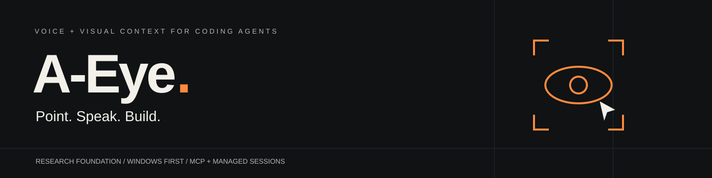
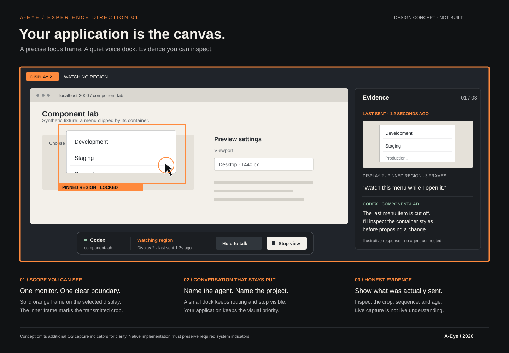

<p align="center"></p>

<p align="center"><strong>A voice and visual-context companion for coding agents.</strong><br>Show the problem. Keep the conversation. Stay in your workflow.</p>

<p align="center"><a href="docs/PRODUCT.md">Product vision</a> · <a href="docs/architecture/SYSTEM.md">Architecture</a> · <a href="docs/design/EXPERIENCE.md">Design direction</a> · <a href="docs/planning/ROADMAP.md">Roadmap</a> · <a href="docs/research/FINDINGS.md">Research</a></p>

> **Status: research and architecture foundation.** No desktop application, capture service, voice engine, or agent adapter is implemented yet. Images below are design concepts, not screenshots of working software. Research reviewed October 15, 2026. MIT licensed.

## “Look where I'm pointing.”

You can see the clipped dropdown. Explaining its location, recording the interaction, saving a screenshot, and attaching it breaks your concentration.

**A-Eye's proposed workflow:** point at the problem, talk to your coding agent, and give that conversation the right visual evidence. Keep an orange border on the monitor being observed. Stop sharing immediately when the inspection is over.

| Say | Proposed behavior |
| --- | --- |
| “Look here. Why is this menu clipped?” | Send a cursor-anchored crop with your request. |
| “Watch here while I open it.” | Observe a bounded region and select useful frames over time. |
| “Watch this screen.” | Observe one explicitly selected monitor. |
| “Explain it before changing anything.” | Keep the investigation in the agent's read-only mode. |
| “Check it again.” | Acquire fresh evidence and compare the visible result. |
| “Stop watching.” | Stop capture and invalidate unsent observations locally. |

## Live, with precise meaning

A-Eye is designed for **live local capture and adaptive visual updates**. Capture rate, frame delivery rate, and agent reasoning rate are different. A busy coding agent does not interpret every frame. The interface must show both what is being captured and the age of the last image actually sent.

| Integration path | Purpose | Boundary |
| --- | --- | --- |
| **MCP companion** | Give an existing compatible CLI screen-inspection tools. | MCP alone does not inject spoken user turns or provide full voice conversation. |
| **Managed session** | Run a supported agent integration with voice, images, streamed responses, and approvals. | A-Eye manages that session; arbitrary running-terminal attachment is not promised. |

Codex and Claude are target integrations. Their capabilities, authentication, and session semantics are **not assumed identical**. See the [integration matrix](docs/architecture/AGENT-INTEGRATIONS.md).

## A recognizable interface



A-Eye should feel like a small instrument beside your editor: graphite surfaces, warm white type, precise orange lines, a clear session label, and visible evidence age. No obligatory dashboard, animated orb, or wall of metric cards.

The [experience specification](docs/design/EXPERIENCE.md) defines layouts, dimensions, accessibility, copy, and failure states. The [design brief](docs/design/BUILD-BRIEF.md) gives implementers concrete instructions.

## Proposed full stack

| Layer | Direction |
| --- | --- |
| Desktop | Tauri 2; React + TypeScript + Vite interface |
| Native core | Rust; Windows Graphics Capture first; native cursor and monitor handling |
| Agent integrations | Codex app-server adapter; Claude Agent SDK in a constrained Node sidecar |
| Tool interoperability | Local MCP over stdio; official TypeScript SDK candidate |
| Voice | Replaceable STT/TTS providers; push-to-talk first; realtime experiment later |
| Local state | SQLite metadata; OS credential store for secrets |
| Validation | Rust/TypeScript tests, accessibility checks, native Windows acceptance runs |
| Distribution | Signed Windows installer and signed updates after packaging proof |
| Cloud backend | None required initially; model/voice provider traffic remains explicit |

These are proposed decisions, subject to technical spikes. See [stack tradeoffs](docs/architecture/STACK.md).

## Start here

1. Read [product scope](docs/PRODUCT.md) and [research findings](docs/research/FINDINGS.md).
2. Follow the [system architecture](docs/architecture/SYSTEM.md) and [runtime flows](docs/architecture/FLOWS.md).
3. Run the [first technical spikes](docs/planning/ROADMAP.md#phase-0--prove-the-interfaces).
4. Build the smallest complete workflow: **point → speak → inspect → respond → stop**.

There is no application install command yet. Check this documentation foundation with Python 3.10+:

```bash
git clone https://github.com/EvanGUTK/A-Eye.git
cd A-Eye
python scripts/check_docs.py
```

## Documentation map

| Area | Read |
| --- | --- |
| Vision | [Product](docs/PRODUCT.md) |
| Evidence | [Findings](docs/research/FINDINGS.md), [sources](docs/research/SOURCES.md) |
| Structure | [System](docs/architecture/SYSTEM.md), [flows](docs/architecture/FLOWS.md), [repository layout](docs/architecture/REPOSITORY.md) |
| Specification | [Stack](docs/architecture/STACK.md), [agents](docs/architecture/AGENT-INTEGRATIONS.md), [capture](docs/architecture/CAPTURE.md), [voice](docs/architecture/VOICE.md), [contracts](docs/architecture/CONTRACTS.md) |
| Linux platform | [Linux architecture](docs/architecture/LINUX.md), [OAuth](docs/architecture/OAUTH.md), [local model](docs/architecture/LOCAL-MODEL.md) |
| Interface | [Experience](docs/design/EXPERIENCE.md), [build brief](docs/design/BUILD-BRIEF.md) |
| Delivery | [Roadmap](docs/planning/ROADMAP.md), [backlog](docs/planning/BACKLOG.md), [quality](docs/planning/QUALITY.md), [risks](docs/planning/RISKS.md) |
| Decisions | [Decision record](docs/decisions/README.md) |
| Contribution | [Contributing](CONTRIBUTING.md), [security](SECURITY.md), [agent instructions](AGENTS.md) |

## Principles

- The selected coding session is the authority for code work.
- The user controls capture scope; the model cannot silently expand it.
- Orange means active capture, not continuous model attention.
- Screen content is evidence, not instructions or permission.
- Local processing does not make cloud inference offline.
- Useful releases have acceptance criteria; the product can keep evolving.

Independent project by Evan Goodman. Not affiliated with OpenAI or Anthropic. Provider names describe intended compatibility, not a partnership or completed integration. Existing [MIT license](LICENSE) retained.
