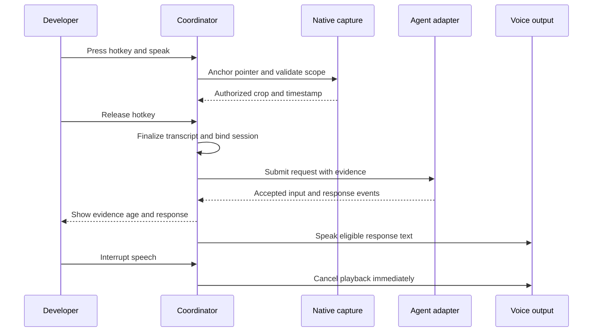
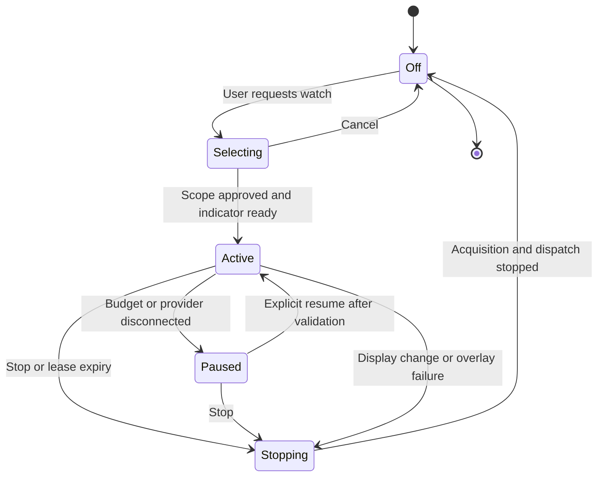
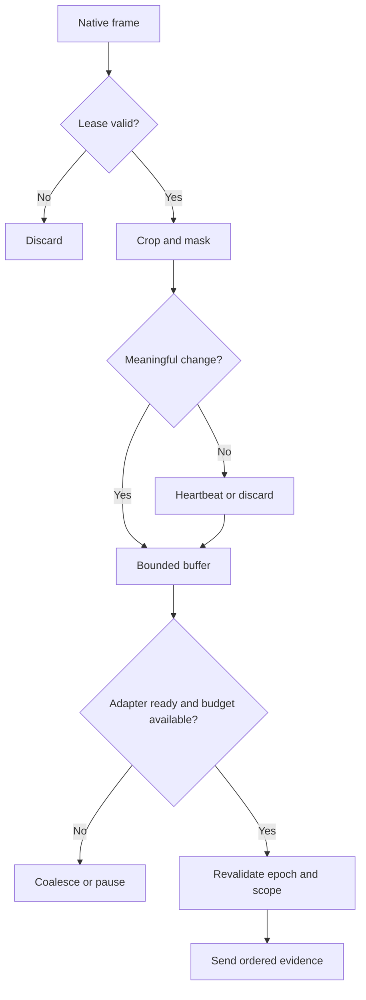

# Runtime flows

These diagrams specify proposed behavior, including failure paths.

## Point and ask

Anchoring does not itself authorize capture. With no active lease, request local scope approval before acquisition. In single-shot mode the border appears for capture, then disappears when acquisition ends; the evidence drawer continues to identify the captured artifact.

## Watch-region lifecycle

The native core owns this transition, not the model. Permission revocation, screen lock, sleep, topology invalidation, and unexpected child-process failure stop or pause according to policy. Resume never silently selects a different monitor.

## Live evidence selection

Thresholds must be evaluated against tiny text changes and brief animation. Cursor motion alone should not flood evidence when the selected region is pinned.

## Stop and cancellation semantics

1. User activates stop by button or configurable global hotkey; this path never depends on cloud speech recognition.
2. Core revokes the capture lease and increments its epoch.
3. Stop acquisition, reject new requests, discard queued crops and unsent voice-associated evidence.
4. Cancel in-flight transmissions where possible. Already sent data cannot be retracted by a local stop.
5. Remove the active indicator after acquisition stops; show a local completion state.
6. Ignore stale callbacks carrying the old epoch. Keep the provider's ongoing code task separate unless the user also selects stop work.

“Stop everything” explicitly combines capture stop, microphone stop, playback cancellation, and a best-effort agent interrupt. Report any unacknowledged agent cancellation rather than claiming work stopped.

## Fix and verify

Observe → explain uncertainty → inspect source → propose action → provider approval → agent edit/test → user reproduces UI → acquire fresh evidence → compare.

Before/after comparison requires the same scope or a documented transform, matching application state, and capture timestamps. A visual improvement is not proof of all code correctness. Do not silently click or deploy to complete this loop.
