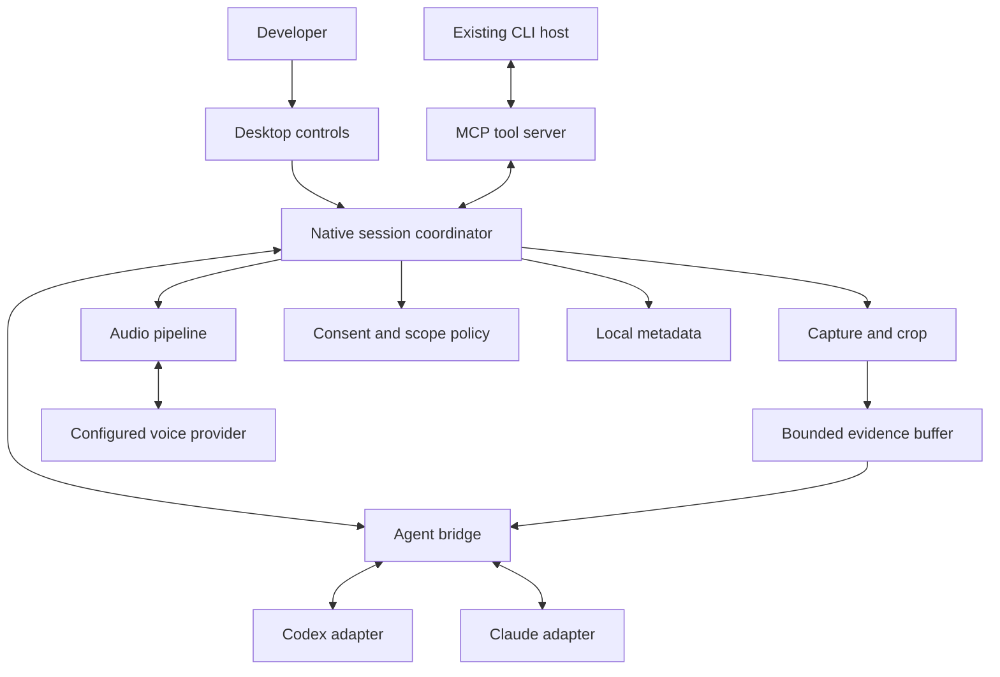

# System architecture

Status: proposed. See [research](../research/FINDINGS.md) for evidence and limitations.

## Structural model

Provider-backed agents and voice services may transmit data off-device. “Local companion” describes where control and capture live, not an all-offline product.

## Process boundaries

| Process | Owns | Must not own |
| --- | --- | --- |
| Tauri renderer | Dock, session chooser, evidence drawer, settings, keyboard UI | Credentials, raw shell execution, capture permission decisions |
| Rust core | Session coordinator, native capture, scope leases, overlay lifecycle, cancellation, local metadata | Provider-specific chat protocol in UI components |
| Agent bridge sidecar | Provider adapters, normalized agent events, optional MCP entry point | Unilateral capture expansion, global approval defaults |
| Provider CLI/runtime | Repository-aware agent loop and its tool policy | A-Eye's native capture permissions |
| Optional local STT process | Audio-to-text inference | Repository edits or display access |

Initial implementation may use one TypeScript bridge executable with separate `agent` and `mcp` entry modes. Keep credentials and per-session authorization scoped even when code is shared. Do not build a fleet of independent services before a measured need.

## Communication design

Renderer → core: narrow typed Tauri commands and events. Core → managed sidecar: framed messages over private inherited pipes. Existing MCP clients start a stdio bridge, which connects to the running native core through a current-user-only named pipe on Windows. Use an instance nonce, connection-specific session binding, restrictive ACLs, message-size bounds, and request deadlines. Unix-domain sockets are a later platform equivalent.

No unauthenticated localhost HTTP port is needed. If a later browser or remote client needs networking, introduce explicit origin validation, authentication, TLS where remote, and a separate threat-model revision.

The MCP server must keep protocol output on stdout and diagnostics on stderr. Never return arbitrary filesystem paths as a substitute for host-accessible image data.

## Coordinator responsibilities

Maintain a registry of projects, provider sessions, capture leases, provider capabilities, and outstanding requests. One managed writer owns each provider session. Each utterance, frame, approval, response, and cancellation carries explicit correlation identifiers.

Before dispatch, check:

1. Session binding still matches the user-visible selected project/agent.
2. Scope lease is active and its epoch matches the evidence.
3. Crop is inside the authorized region; redactions are already applied.
4. Evidence is sufficiently recent for the request.
5. Adapter accepts the input type and its bounded queue has capacity.
6. The current operation has not been cancelled or superseded.

Dispatch is serialized per provider conversation. Control events such as stop bypass bulk evidence queues. On provider disconnect, pause observation by default and require explicit restart after reconnection. Never silently replay a code-changing request.

## State should be orthogonal

Avoid one enormous state variable. Represent four coordinated state machines:

| Domain | Example states |
| --- | --- |
| Capture | off, selecting, active, paused, stopping, error |
| Microphone | muted, armed, recording, transcribing, error |
| Agent | disconnected, idle, running, approval_pending, cancelling, error |
| Playback | silent, buffering, speaking, interrupted |

For example, the agent can be running while capture is off; stopping capture must not misleadingly imply that an in-progress code operation was cancelled. Provide a separate stop-work action.

## Data boundaries

Raw screen surfaces remain in the native capture layer. Crop/mask before handing images to the sidecar. Encoded crops live in bounded memory. Store preferences and provider session identifiers in SQLite. Credentials stay in the OS credential store. Retained transcript/evidence history is opt-in; provider runtimes may retain their own histories independently.

Suggested metadata tables:

| Table | Purpose |
| --- | --- |
| projects | User-selected project identifier and path |
| agent_sessions | Provider, provider session ID, project binding, last status |
| preferences | Non-secret versioned settings |
| audit_events | Minimal consent/stop/error event metadata, no pixels or utterances |
| schema_migrations | Ordered, reversible where possible metadata migrations |

A history setting must not promise deletion from a provider that A-Eye does not control. Reconnect resumes conversational context only through supported provider behavior.

## Extensibility

Keep capture, audio, and agents behind narrow interfaces. Add another provider by implementing capability discovery, session lifecycle, evidence submission, events, approvals, cancellation, and explicit unsupported cases. Never force a weak adapter to claim parity.

Future A2A can sit above the coordinator if actual delegation becomes a product requirement. It is unnecessary for a user talking to one coding agent.
